# Backend Development Fundamentals – Lab 3
## REST API Development, Query Parameters, Validation and Debugging

**Student Name:** Chikoti Sai Kumar  
**Registration Number:** 252U1R1060
**Course:** Backend Development Fundamentals  
**Year:** II  
**Lab Number:** 03

---

## 1. Project Overview

This project is an upgraded Bookstore REST API developed using Node.js, Express.js and SQLite.

The application allows users to perform CRUD operations (Create, Read, Update and Delete) on book records. It also supports searching, sorting, pagination, price filtering, input validation and error handling.

## 2. Technologies Used

- Node.js
- Express.js
- SQLite
- JavaScript
- Postman
- Visual Studio Code
- GitHub
- Render

## 3. Project Objectives

- Develop RESTful API endpoints using proper HTTP methods.
- Perform CRUD operations on book records.
- Implement query parameters for searching and sorting.
- Add pagination using limit and offset.
- Filter books based on price range.
- Validate user input before database operations.
- Handle errors using appropriate HTTP status codes.
- Test API functionality using Postman.
- Deploy the application using Render.

## 4. Features Implemented

1. Get all books.
2. Get a specific book using its ID.
3. Add a new book.
4. Update existing book details.
5. Delete a book.
6. Search books using partial title matching.
7. Sort books by ID, title, author or price.
8. Support ascending and descending sorting.
9. Display records using pagination.
10. Filter books using minimum and maximum prices.
11. Validate book details before insertion or updating.
12. Handle invalid requests and missing book records.

## 5. API Endpoints

| HTTP Method | Endpoint | Description |
|---|---|---|
| GET | `/books` | Retrieve all books |
| GET | `/books/:id` | Retrieve a specific book |
| POST | `/books` | Add a new book |
| PUT | `/books/:id` | Update an existing book |
| DELETE | `/books/:id` | Delete a book |

## 6. Query Parameters

The API supports the following query parameters:

| Parameter | Description |
|---|---|
| `search_q` | Search books by title |
| `order_by` | Select the column for sorting |
| `order` | Sort in ASC or DESC order |
| `limit` | Set the number of records |
| `offset` | Skip a specified number of records |
| `min_price` | Set the minimum price |
| `max_price` | Set the maximum price |

### Example Requests

**Search books:**
```http
GET /books?search_q=Python
```

**Sort by price:**
```http
GET /books?order_by=price&order=DESC
```

**Pagination:**
```http
GET /books?limit=5&offset=0
```

**Price range filtering:**
```http
GET /books?min_price=300&max_price=600
```

## 7. HTTP Status Codes

| Status Code | Description |
|---|---|
| 200 OK | Request completed successfully |
| 201 Created | Book created successfully |
| 400 Bad Request | Invalid input or validation error |
| 404 Not Found | Requested book does not exist |
| 500 Internal Server Error | Server-side error |

## 8. Project Screenshots

The following screenshots demonstrate the application interface and API testing performed using Postman.

### 1. Home Page
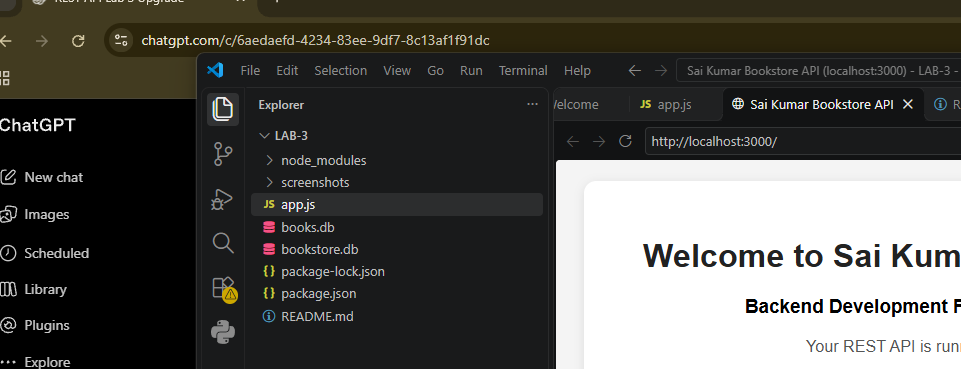

### 2. Get All Books
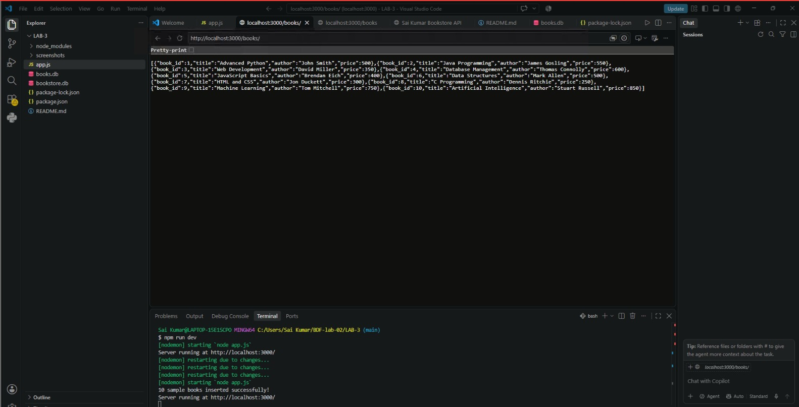

### 3. Get Single Book
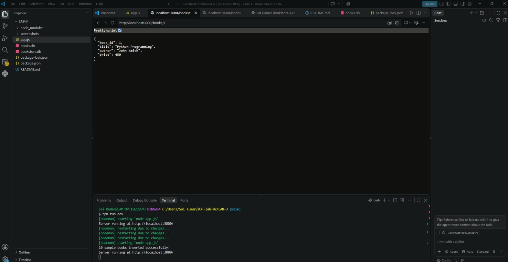

### 4. Update Book – PUT
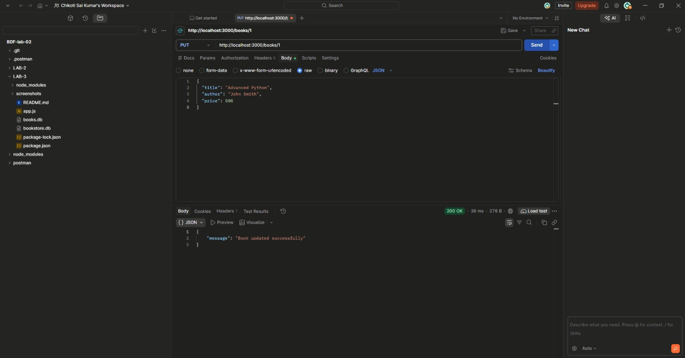

### 5. Delete Book
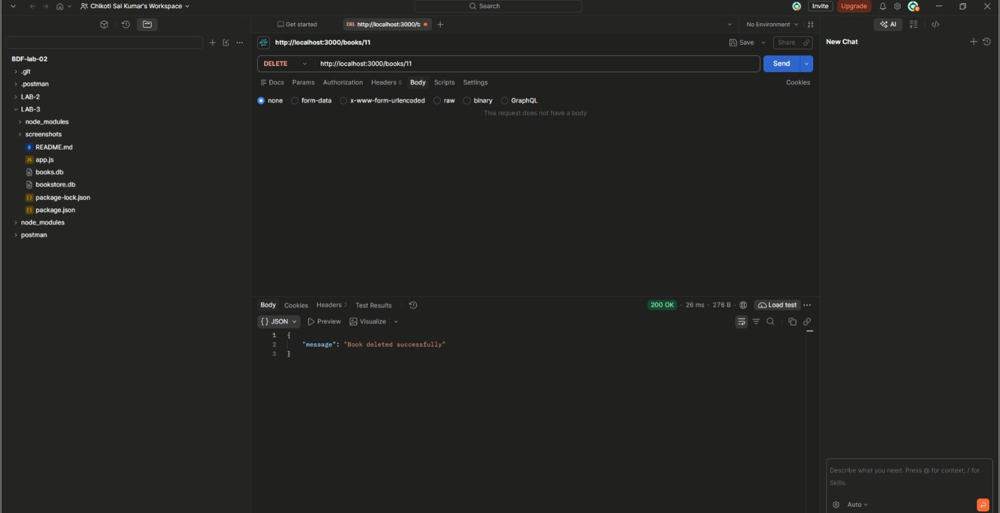

### 6. Search Books
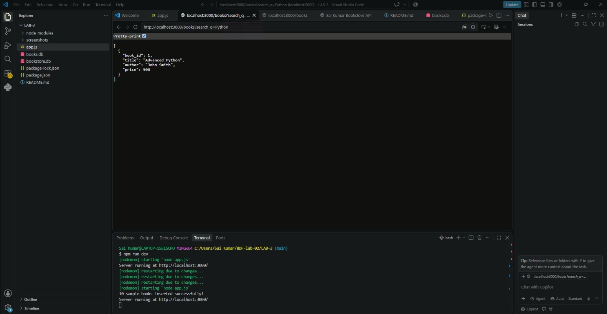

### 7. Sorting Books
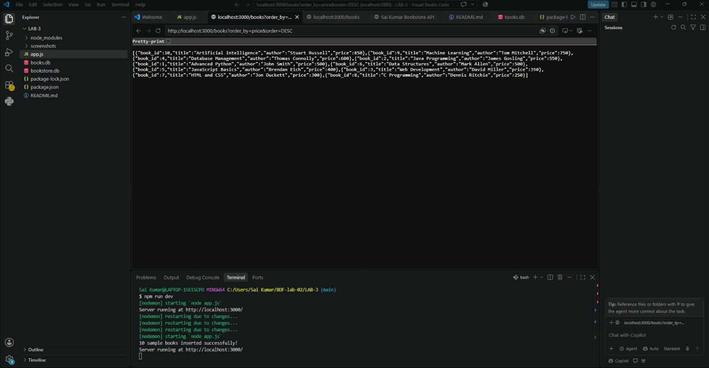

### 8. Price Filtering
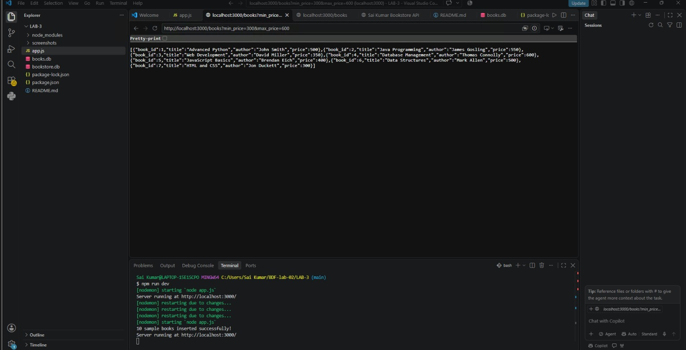

### 9. Pagination
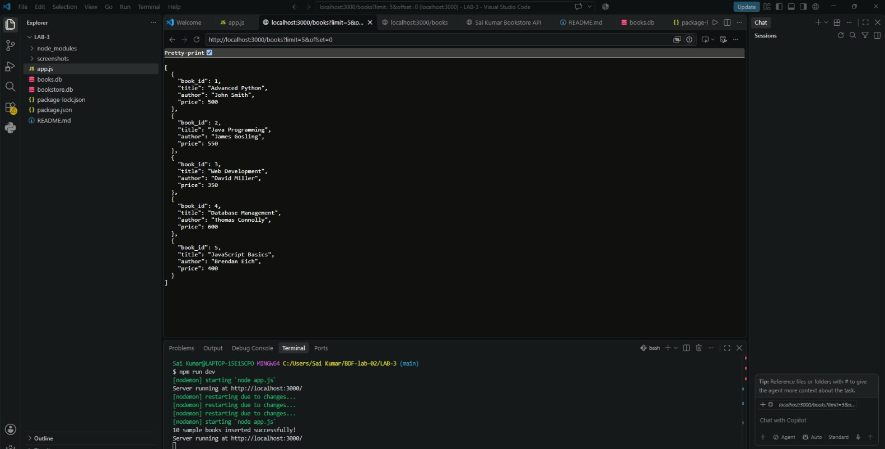

### 10. Add Book – POST
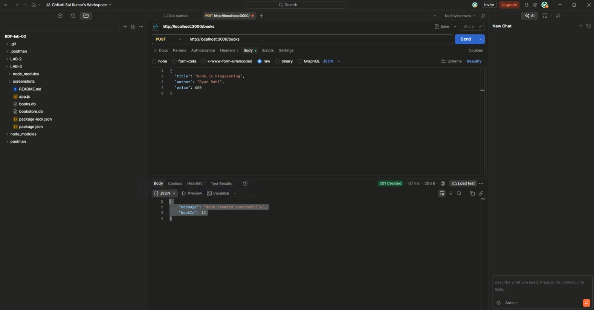

### 11. Bad Request Testing
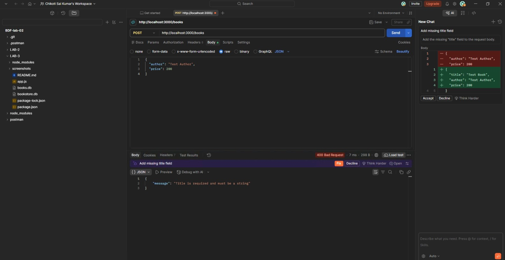

## 9. Project Installation and Execution

### Step 1: Clone the Repository

```bash
git clone https://github.com/chikotisaikumar08-tech/BDF-lab-02.git
```

### Step 2: Navigate to the Lab 3 Folder

```bash
cd BDF-lab-02/LAB-3
```

### Step 3: Install Dependencies

```bash
npm install
```

### Step 4: Start the Server

```bash
npm start
```

### Step 5: Access the Application

Open the following URL in your browser:

```text
http://localhost:3000/
```

Use Postman to test the API endpoints.

## 10. GitHub Repository

**Project Repository:**

https://github.com/chikotisaikumar08-tech/BDF-lab-02/tree/main/LAB-3

The repository contains the Lab 3 source code, database files, screenshots and project documentation.

## 11. Live Deployment

**Platform:** Render

**Live Application URL:**

https://bdf-lab-03-x4sz.onrender.com/

## 12. Conclusion

This lab helped me understand how to develop RESTful APIs using Node.js, Express.js and SQLite. I gained practical experience in implementing CRUD operations, query parameters, searching, sorting, pagination and price filtering.

I also learned how to validate user inputs, handle errors using HTTP status codes and test API endpoints using Postman. Finally, I gained experience in maintaining the project on GitHub and deploying a backend application using Render.
