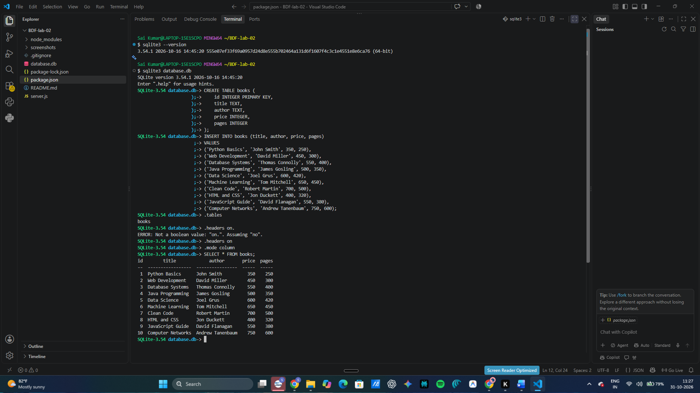
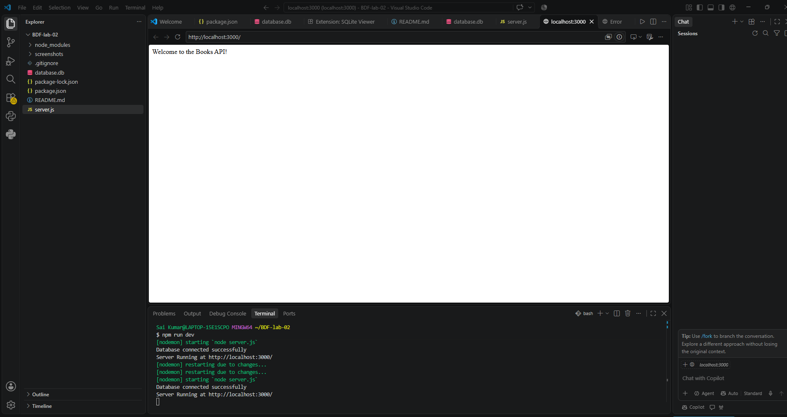
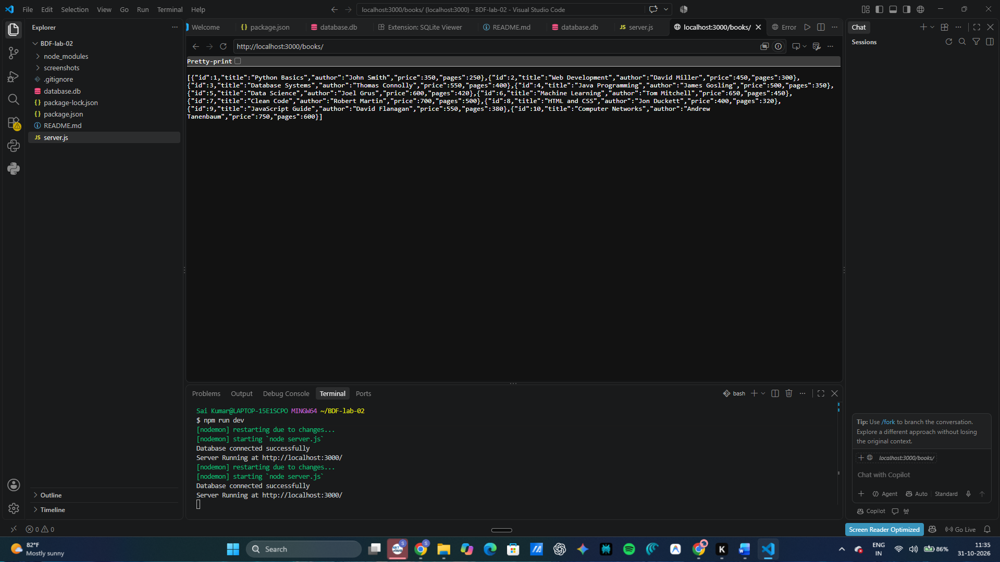
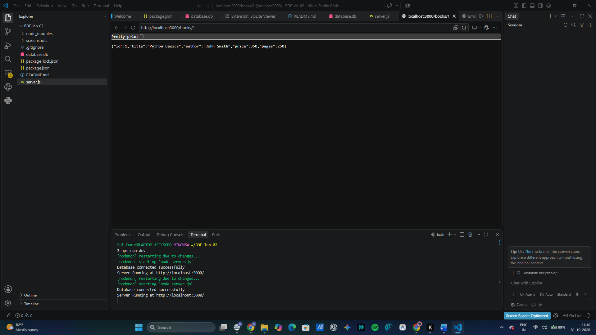
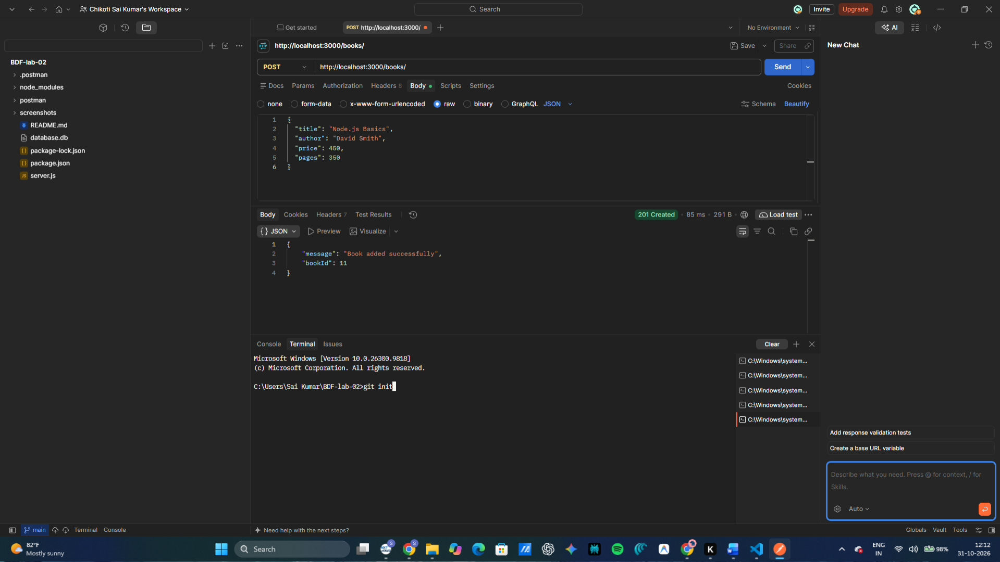
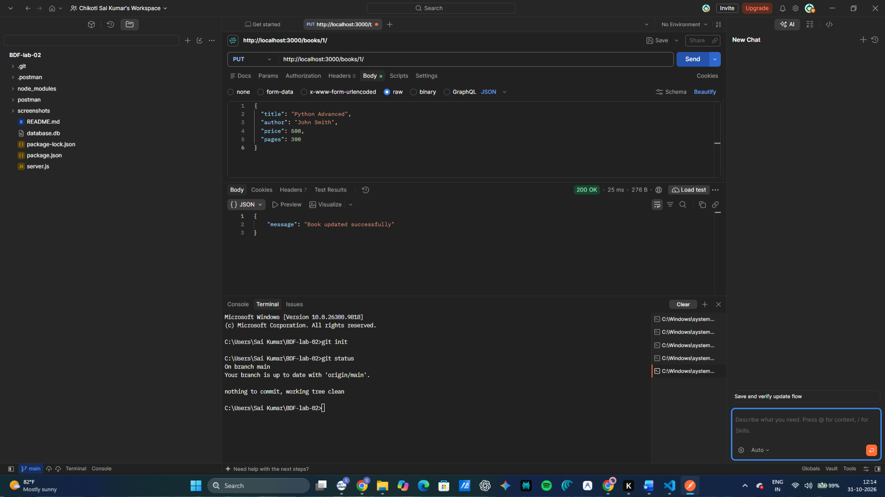
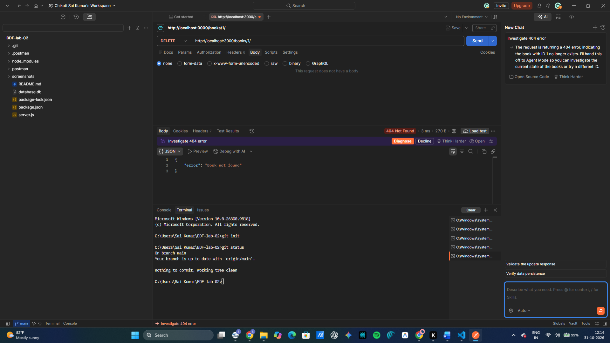

# Lab 02 – SQLite Database and CRUD Routes

## Student Details

- **Name:** Chikoti Sai Kumar
- **Registration Number:** 252U1R1060
- **Course:** Backend Development Fundamentals
- **Year:** II Year
- **Term:** II
- **Lab Number:** 02

## 1. Aim

To create an SQLite database and develop REST API routes using Node.js and Express.js to perform CRUD operations (Create, Read, Update, and Delete).

## 2. Technologies Used

- Node.js
- Express.js
- SQLite
- SQLite3
- Postman
- Nodemon
- Visual Studio Code

## 3. Project Structure

BDF-lab-02/
│
├── screenshots/
│   ├── 1-database.png
│   ├── 2-homepage.png
│   ├── 3-getall.png
│   ├── 4-getone.png
│   ├── 5-post.png
│   ├── 6-put.png
│   └── 7-delete.png
│
├── database.db
├── server.js
├── package.json
├── package-lock.json
├── .gitignore
└── README.md

## 4. Installation

Install the required packages using:

```bash
npm install
```

Required packages:

```bash
npm install express sqlite sqlite3
npm install --save-dev nodemon
```

## 5. Run the Application

Start the server using:

```bash
npm run dev
```

Server URL:

```text
http://localhost:3000/
```

Expected terminal output:

```text
Database connected successfully
Server Running at http://localhost:3000/
```

## 6. Database Details

Database Name: `database.db`

Table Name: `books`

The table contains the following columns:

| Column | Data Type |
|---|---|
| id | INTEGER PRIMARY KEY |
| title | TEXT |
| author | TEXT |
| price | INTEGER |
| pages | INTEGER |

A total of 10 sample book records were inserted into the database.

## 7. API Endpoints

The following REST API endpoints are implemented:

| HTTP Method | Endpoint | Description |
|---|---|---|
| GET | `/books/` | Retrieve all books |
| GET | `/books/:bookId/` | Retrieve a single book |
| POST | `/books/` | Add a new book |
| PUT | `/books/:bookId/` | Update an existing book |
| DELETE | `/books/:bookId/` | Delete a book |

## 8. API Testing Screenshots

All API endpoints were tested using Postman.

### 1. Database Records



### 2. Homepage



### 3. GET All Books



### 4. GET Single Book



### 5. POST – Add Book



### 6. PUT – Update Book



### 7. DELETE – Delete Book



## 9. SQL Query Safety

All user inputs are passed using parameterized SQL queries with `?` placeholders to prevent SQL injection.

## 10. Environment Variables

No environment variables are required for this project.

## 11. Challenges Faced and Solutions

- **SQLite CLI not found:** Installed SQLite command-line tools and configured the system PATH.
- **Server connection issue:** Started the Node.js server using Nodemon.
- **Postman connection refused:** Resolved the issue by running the server before sending API requests.
- **Git setup:** Initialized Git to track project changes.

## 12. Conclusion

In this lab, I successfully created an SQLite database and connected it with a Node.js and Express.js application. I implemented all five required API routes to perform CRUD operations on book records. I also tested the APIs using Postman and verified the database operations.

This lab helped me understand database connectivity, REST API development, parameterized SQL queries, and API testing.
